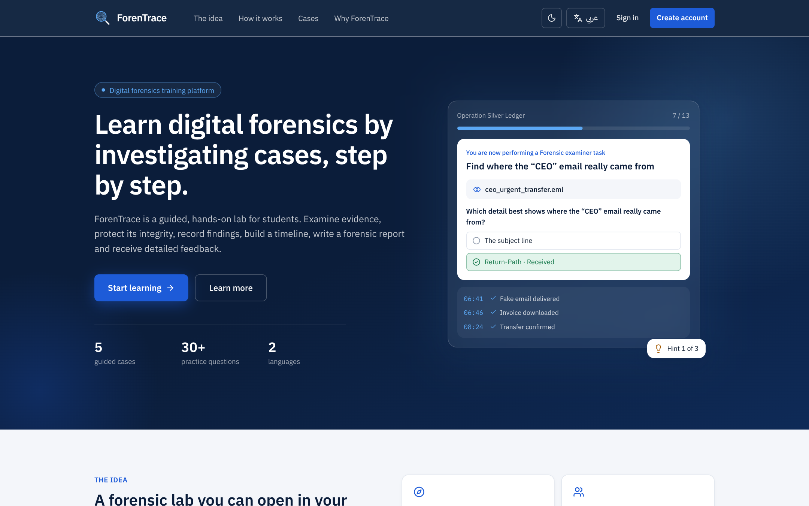
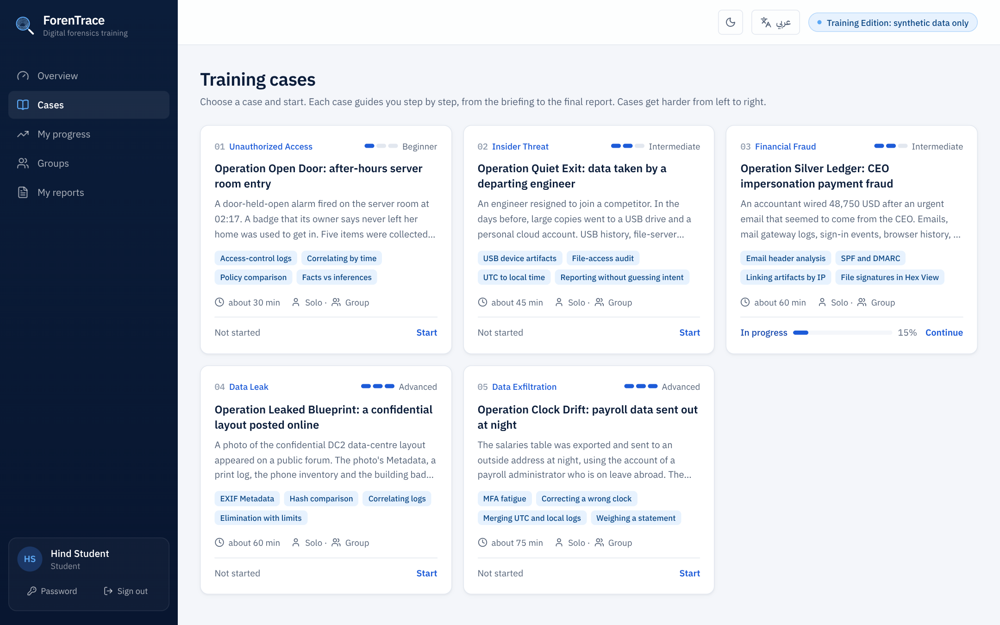
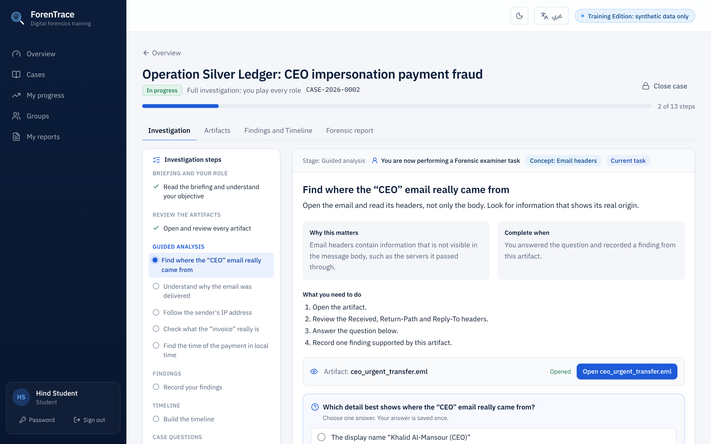
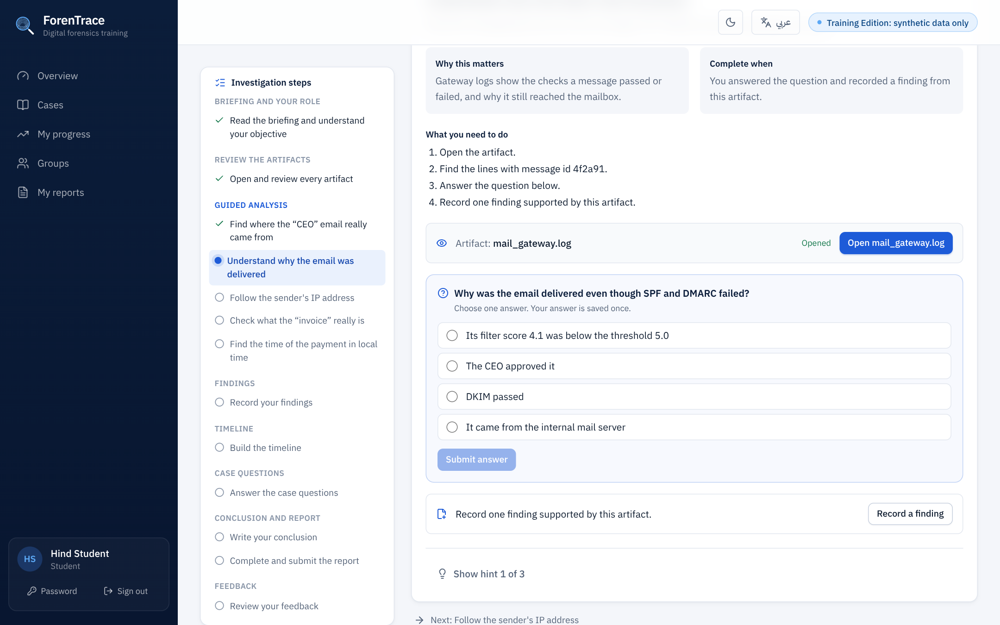
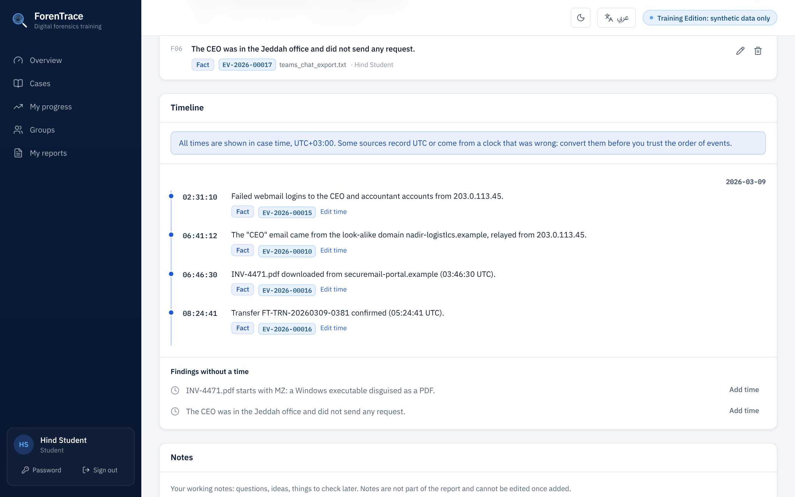
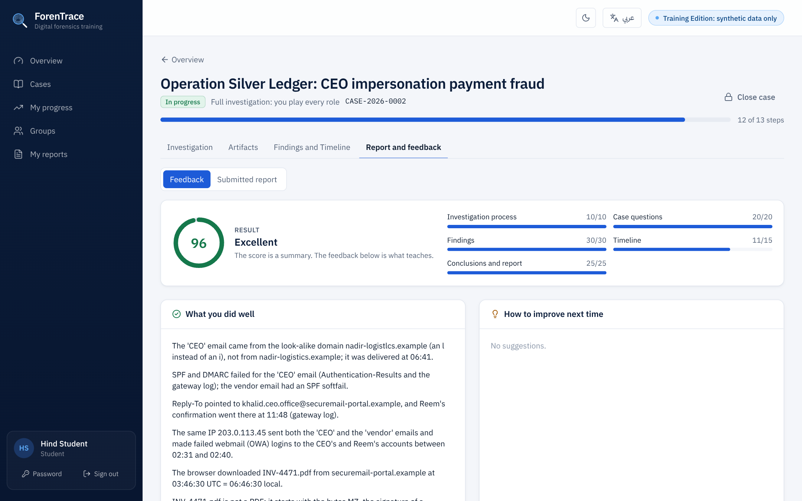

# 🔍 ForenTrace

### Learn digital forensics by actually investigating.

Open a case, examine the evidence, answer the questions, build the timeline and write a real forensic report, with a guide beside you at every step.

**[▶ Try it live: forentrace.onrender.com](https://forentrace.onrender.com)**

English · العربية · Light · Dark · Desktop · Phone

 

---

> **منصة عربية/إنجليزية لتعلّم التحقيق الجنائي الرقمي بالتطبيق.** تفتح قضية، تفحص الأدلة، تجاوب على الأسئلة، تبني الـ Timeline، وتكتب تقريرًا جنائيًا حقيقيًا، والمنصة ترشدك خطوة بخطوة وتعطيك تقييمًا في النهاية.

---

## ✨ Why ForenTrace is different

Most forensics courses are slides and theory. ForenTrace puts you **inside a case**:

- 🧭 **A guide, not a manual.** One clear task at a time, with why it matters and hints when you are stuck.
- 🔬 **Real-looking evidence.** Emails with full headers, logs, browser history, photos with EXIF and files you open in a Hex view.
- ❓ **Learn by answering.** Questions inside the case check your reasoning and explain the answer straight away.
- 🕒 **Findings and a timeline.** Every finding points to the evidence behind it and lines up in time.
- 📝 **A real forensic report.** Each section tells you what to write, why it matters and gives an example. Your draft saves itself.
- 🎯 **Feedback on your work.** A score, a review of your report and clear tips for next time.

---

## 🗂 The case library

Five cases, from first steps to advanced, each teaching its own skills.

| # | Case | Type | Level | Time | You will practise |
|---|------|------|-------|------|-------------------|
| 01 | **Operation Open Door**: after-hours server room entry | Unauthorized access | Beginner | ~30 min | Access-control logs, correlating by time, facts vs inferences |
| 02 | **Operation Quiet Exit**: data taken by a departing engineer | Insider threat | Intermediate | ~45 min | USB artifacts, file-access audit, UTC to local time |
| 03 | **Operation Silver Ledger**: CEO impersonation payment fraud | Financial fraud | Intermediate | ~60 min | Email headers, SPF and DMARC, linking by IP, file signatures |
| 04 | **Operation Leaked Blueprint**: a confidential layout posted online | Data leak | Advanced | ~60 min | EXIF metadata, hash comparison, elimination with limits |
| 05 | **Operation Clock Drift**: payroll data sent out at night | Data exfiltration | Advanced | ~75 min | MFA fatigue, correcting a wrong clock, merging time zones |

---

## 🧭 Guided investigation

The case is split into stages: briefing, collection, examination, analysis, timeline, conclusions and report. You always know **what to do now**, **why it matters** and **how far you are**. Leave at any time, and the case picks up where you stopped.

---

## 🔬 Evidence viewers

Open each artifact the way an examiner would: emails with technical headers, log files, CSVs, chat exports, PDFs, photos with their metadata, and a Hex view that reveals what a file really is.

---

## ❓ Questions that teach

Single choice, multiple choice and put-in-order questions sit inside the tasks. You get the answer and the reasoning right after you submit, so every mistake becomes a lesson.

---

## 🕒 Findings and Timeline

Record what you found, link it to its evidence and give it a time. ForenTrace lines everything up on a timeline in the case's time zone, so the story of the incident appears in front of you.

---

## 📝 Write a real forensic report

A professional report structure: summary, request and scope, methods, findings, timeline, conclusions, limitations and evidence disposition. Every section explains **what to write**, **why** and shows **an example**. Your findings and timeline flow into the report automatically, and your draft is saved as you type. Print or save it as PDF.

---

## 🎯 Feedback and report review

After you submit, you get a score across the whole investigation (process, questions, findings, timeline and report) and a detailed review of your report: did you answer the question, cite your evidence, separate facts from guesses and state your limits?

---

## 🌍 Arabic and English, light and dark

The whole platform works in **Arabic (RTL)** and **English**, with professional forensic terms kept where they matter. Switch to dark mode for long sessions.

---

## 📱 Works on your phone

&nbsp;&nbsp;&nbsp;

---

## 👥 Solo or as a team

- **Solo:** play every role yourself, from collecting the evidence to submitting the report.
- **Group:** split the roles (collector, custodian, examiner, analyst and case lead) and work the case together, with chain of custody between team members.

---

## 🧩 What you will learn

Chain of custody · Evidence integrity and hashes · Email header analysis · SPF and DMARC · Log correlation · Time zones and clock drift · File signatures · EXIF metadata · USB and file-access artifacts · Building a timeline · Separating facts from inferences · Writing a forensic report

---

## 🛡 Training data only

Every case, person, company, IP address and domain in ForenTrace is **synthetic** and made up for training. No real data is used.

---

## 🔓 Free to use, private source

ForenTrace was built so that students and anyone interested in digital forensics can learn from it. **The platform is open for everyone to use online.**

To protect the work behind it, the source code, case content and evaluation logic are kept private. This repository shows what ForenTrace offers; it does not contain the code.

> المنصة متاحة للجميع للاستخدام والتعلّم مجانًا، أما الكود وتفاصيل المشروع فهي خاصة حفظًا للحقوق.

Have feedback or an idea for a new case? Open an [issue](../../issues), we would love to hear from you.

---

## ⚙️ Built with

React · TypeScript · Tailwind CSS · FastAPI · PostgreSQL

---

### Ready to open your first case?

**[▶ Start investigating at forentrace.onrender.com](https://forentrace.onrender.com)**

 

© 2026 ForenTrace. All rights reserved.
This repository is a showcase only. The source code is private and is not licensed for copying, modification or redistribution. See [LICENSE](LICENSE).

