

# ForenTrace

### Learn digital forensics by actually investigating.

Open a case, examine the evidence, answer the questions, build the timeline and write a real forensic report, with a guide beside you at every step.

**[Try it live: forentrace.onrender.com](https://forentrace.onrender.com)**

English · العربية · Light · Dark · Desktop · Phone

 

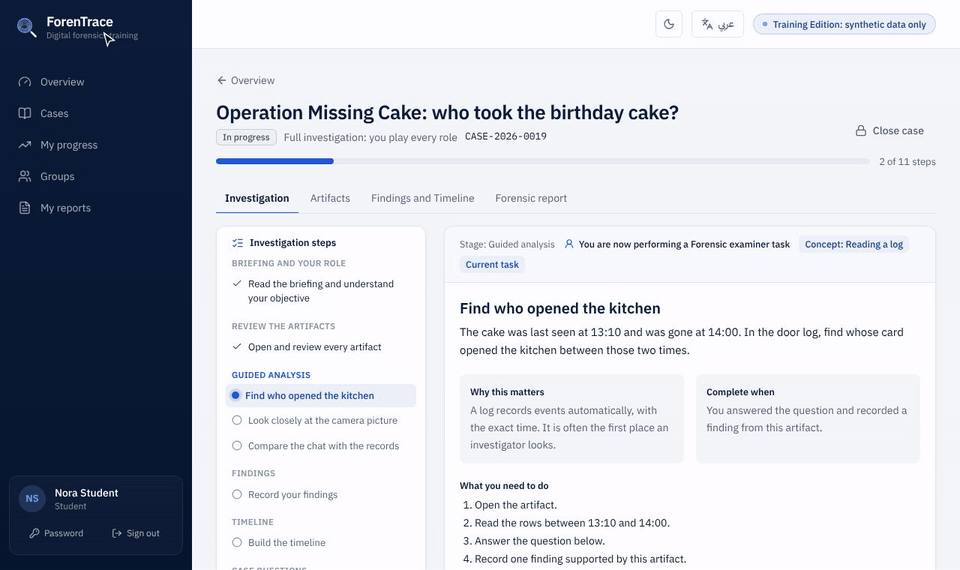

A real run of the warm-up case, start to finish.

---

> **منصة عربية/إنجليزية لتعلّم التحقيق الجنائي الرقمي بالتطبيق.** تفتح قضية، تفحص الأدلة، تجاوب على الأسئلة، تبني الـ Timeline، وتكتب تقريرًا جنائيًا حقيقيًا، والمنصة ترشدك خطوة بخطوة وتعطيك تقييمًا في النهاية.

---

## Can you solve it? The missing birthday cake

Every new investigator starts here. It is a 15-minute puzzle that anyone can solve, even with zero tech background, and it teaches the whole ForenTrace way of working.

> Sara put her birthday cake in the office fridge at noon. At 14:00, right before the party, only the empty plate was left.
> You get a **kitchen door log**, a **camera picture**, the **team chat** and one item that has nothing to do with it. Who took the cake?

**1. Look at the evidence.** The kitchen camera caught someone at 13:47:12. You can see a green jacket and a slice of cake. You can't see a face.

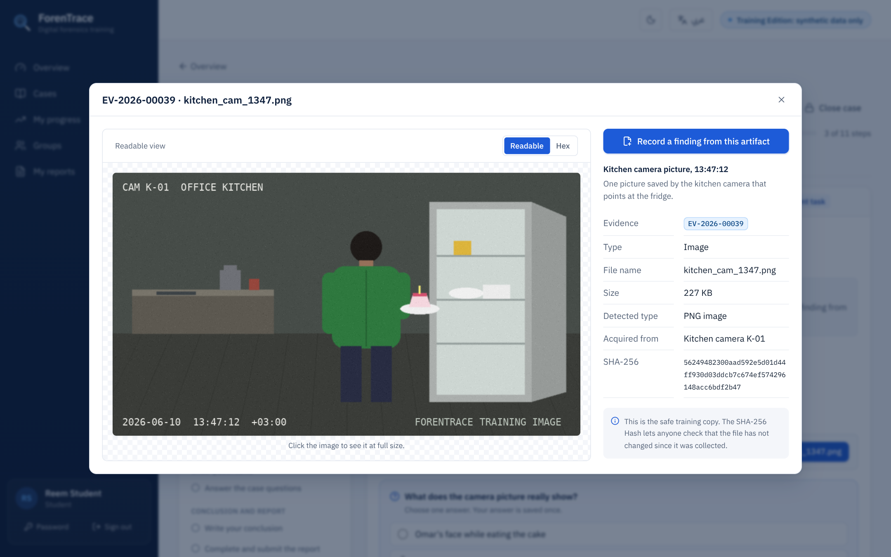

**2. Read the log and answer.** Only one staff card opened the kitchen after the cake was last seen. Answer the question and the platform tells you right away if you're right, and why.

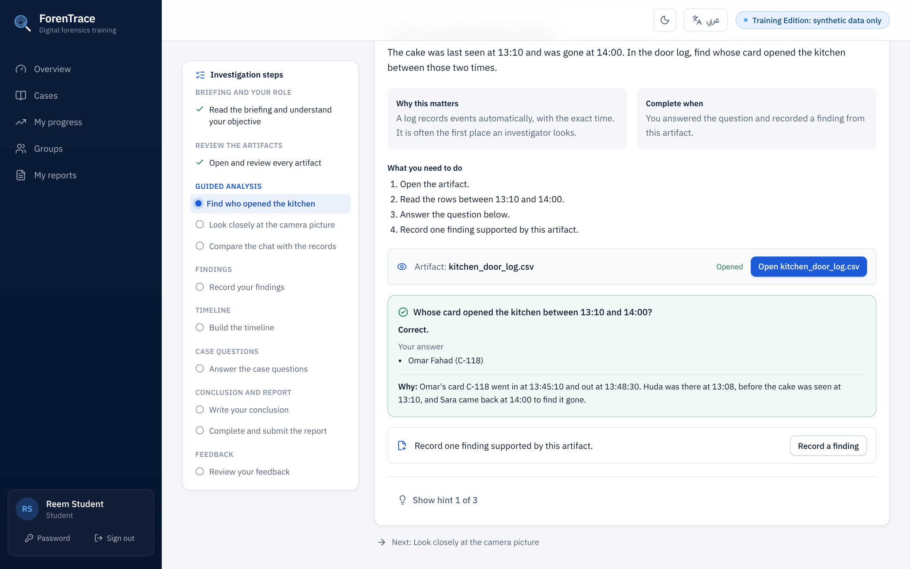

**3. Write it down as a finding.** Each finding is one fact, linked to the evidence that proves it, with the time it happened.

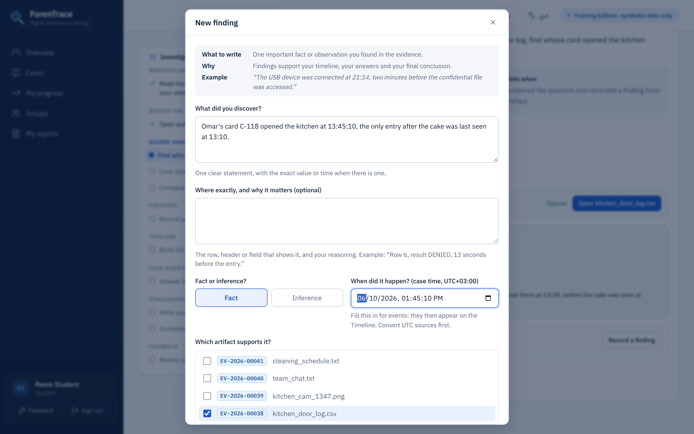

**4. Watch the story appear.** Your findings line up on the timeline. Now the chat message "I was in a meeting all afternoon" doesn't look so good.

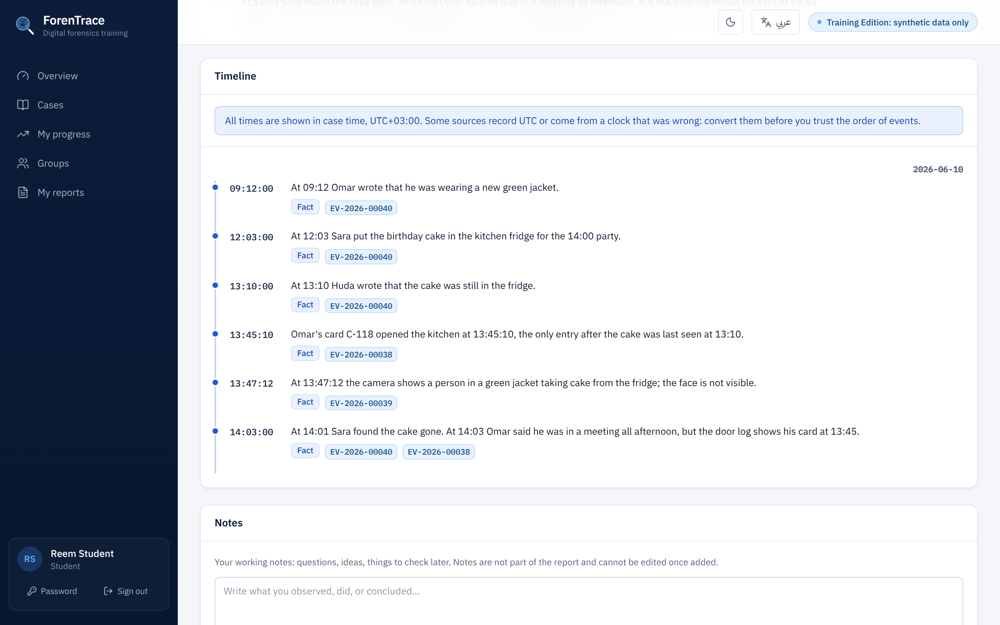

**5. Get your result.** Write a short report and submit it. You get a score, what you did well, what you missed, and why.

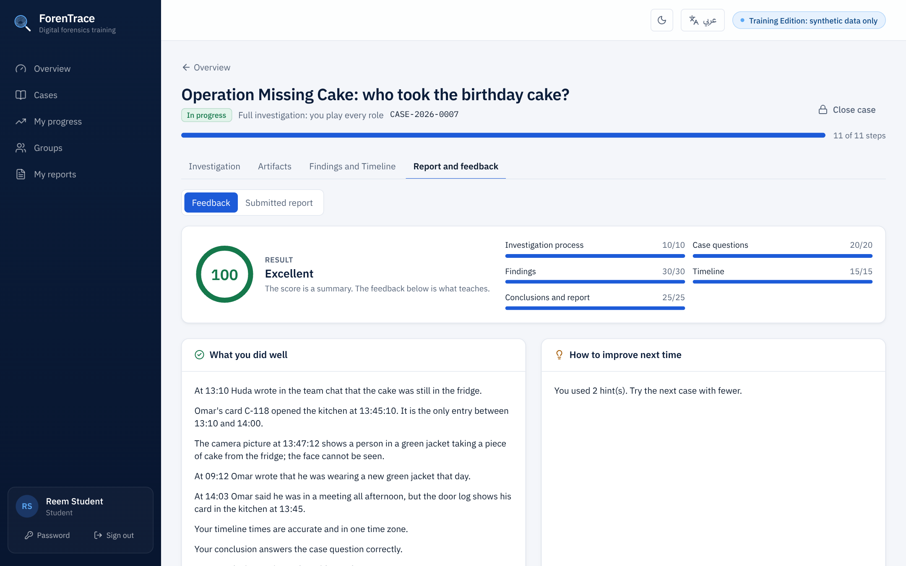

The twist: everything points to one person, but the face is never seen. A good investigator writes "the evidence indicates", not "he did it". ForenTrace checks for exactly that.

---

## Things that surprise people

### The PDF that isn't a PDF

An "invoice" called `INV-4471.pdf` opens straight in Hex view. The first two bytes are `MZ`, the signature of a Windows program, and ForenTrace flags it. The file name lied. The bytes don't.

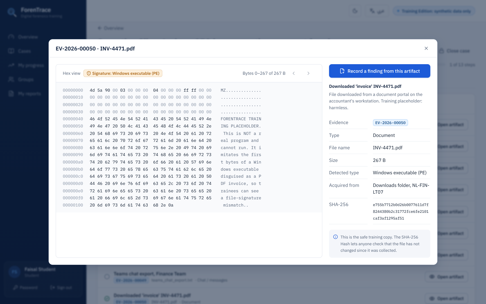

### The email that wasn't from the CEO

It looks like the CEO wrote it. Open the technical headers and the truth shows: it was sent through `nadir-logistlcs` (an **l** where the **i** should be), and any reply goes to an outside address.

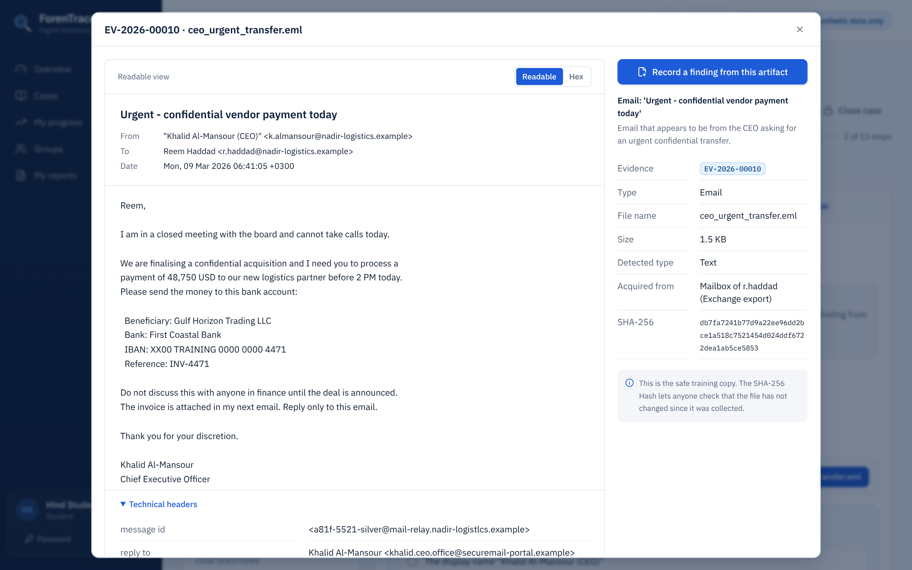

### It tells you when you claim too much

Write "Lina entered the server room" when the log only proves her badge was used, and the feedback calls it out. It also shows the clues you missed and why they mattered.

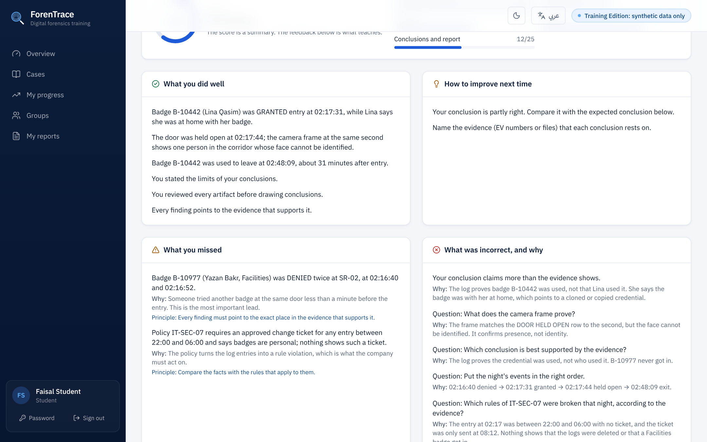

---

## The case library

Six cases, from a warm-up puzzle to advanced investigations, each teaching its own skills.

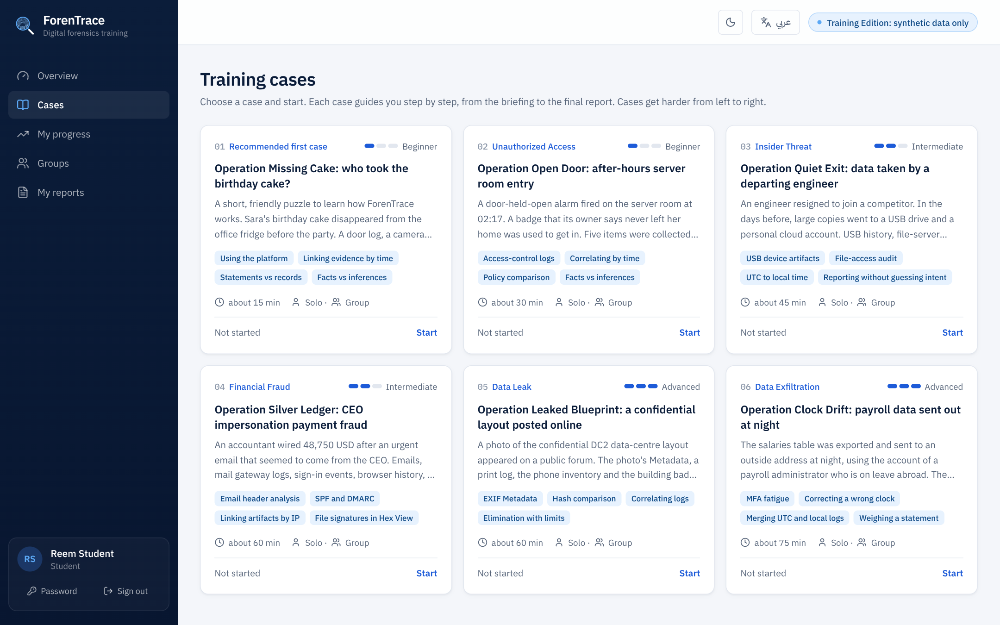

| # | Case | Type | Level | Time | You will practise |
|---|------|------|-------|------|-------------------|
| 01 | **Operation Missing Cake**: who took the birthday cake? | Recommended first case | Beginner | ~15 min | Using the platform, linking evidence by time, statements vs records |
| 02 | **Operation Open Door**: after-hours server room entry | Unauthorized access | Beginner | ~30 min | Access-control logs, correlating by time, facts vs inferences |
| 03 | **Operation Quiet Exit**: data taken by a departing engineer | Insider threat | Intermediate | ~45 min | USB artifacts, file-access audit, UTC to local time |
| 04 | **Operation Silver Ledger**: CEO impersonation payment fraud | Financial fraud | Intermediate | ~60 min | Email headers, SPF and DMARC, linking by IP, file signatures |
| 05 | **Operation Leaked Blueprint**: a confidential layout posted online | Data leak | Advanced | ~60 min | EXIF metadata, hash comparison, elimination with limits |
| 06 | **Operation Clock Drift**: payroll data sent out at night | Data exfiltration | Advanced | ~75 min | MFA fatigue, correcting a wrong clock, merging time zones |

---

## Write a real forensic report

A professional report structure: summary, request and scope, methods, findings, timeline, conclusions, limitations and evidence disposition. Every section explains **what to write**, **why** and shows **an example**. Your findings and timeline flow into the report automatically, and your draft is saved as you type. Print or save it as PDF.

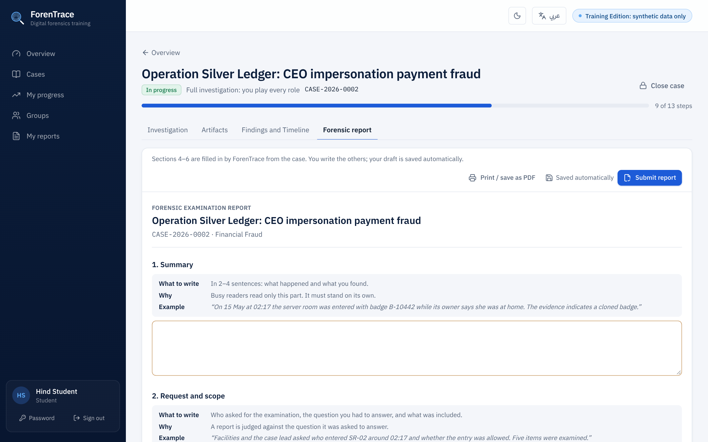

After you submit, the report is reviewed point by point: did you answer the question, cite your evidence, separate facts from guesses and state your limits?

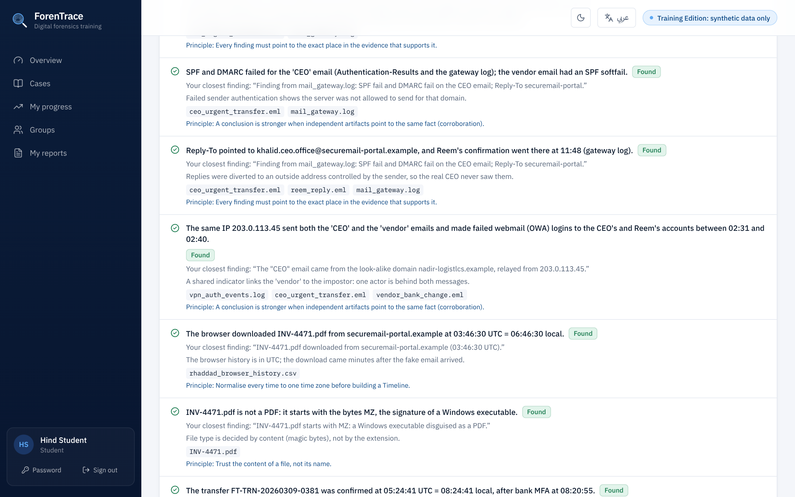

---

## Arabic and English, light and dark

The whole platform works in **Arabic (RTL)** and **English**, with professional forensic terms kept where they matter. Switch to dark mode for long sessions.

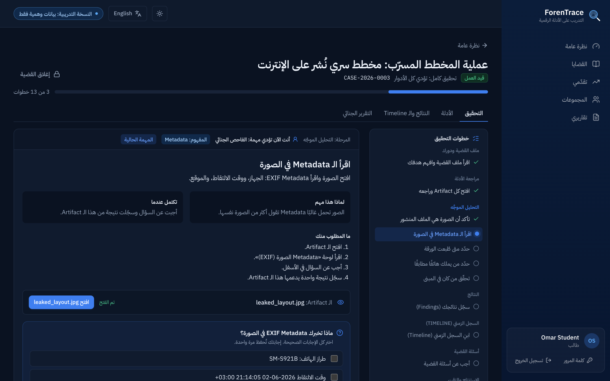
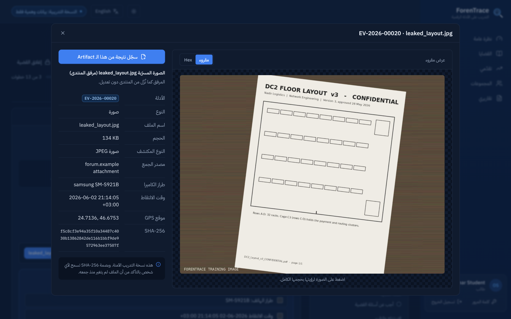

---

## Works on your phone

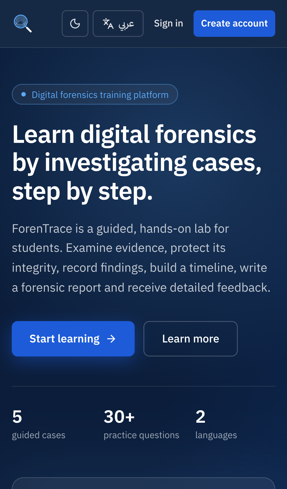
&nbsp;&nbsp;&nbsp;
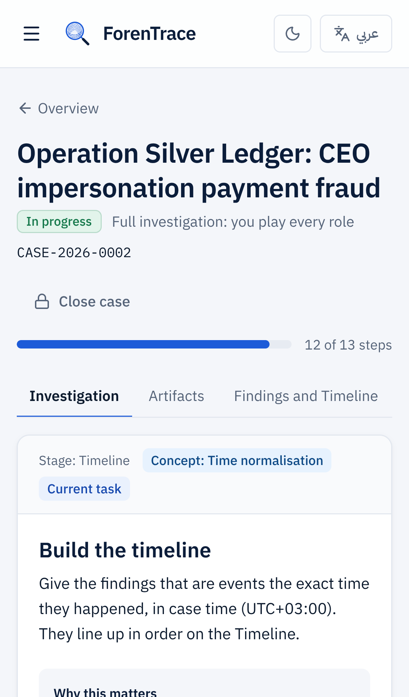

---

## Solo or as a team

- **Solo:** play every role yourself, from collecting the evidence to submitting the report.
- **Group:** split the roles (collector, custodian, examiner, analyst and case lead) and work the case together, with chain of custody between team members.

---

## What you will learn

Chain of custody · Evidence integrity and hashes · Email header analysis · SPF and DMARC · Log correlation · Time zones and clock drift · File signatures · EXIF metadata · USB and file-access artifacts · Building a timeline · Separating facts from inferences · Writing a forensic report

---

## Training data only

Every case, person, company, IP address and domain in ForenTrace is **synthetic** and made up for training. No real data is used.

---

## Free to use, private source

ForenTrace was built so that students and anyone interested in digital forensics can learn from it. **The platform is open for everyone to use online.**

To protect the work behind it, the source code, case content and evaluation logic are kept private. This repository shows what ForenTrace offers; it does not contain the code.

> المنصة متاحة للجميع للاستخدام والتعلّم مجانًا، أما الكود وتفاصيل المشروع فهي خاصة حفظًا للحقوق.

Have feedback or an idea for a new case? Email us at [forentrace.team@gmail.com](mailto:forentrace.team@gmail.com), we would love to hear from you.

---

## Built with

React · TypeScript · Tailwind CSS · FastAPI · PostgreSQL

---

## ForenTrace Team

ForenTrace was designed and built together by:

- **Hoor** · [@HoorFawaz](https://github.com/HoorFawaz)
- **Danah** · [@danahfawaz](https://github.com/danahfawaz)

---

### Ready to open your first case?

**[Start investigating at forentrace.onrender.com](https://forentrace.onrender.com)**

 

© 2026 ForenTrace. All rights reserved.
This repository is a showcase only. The source code is private and is not licensed for copying, modification or redistribution. See [LICENSE](LICENSE).

